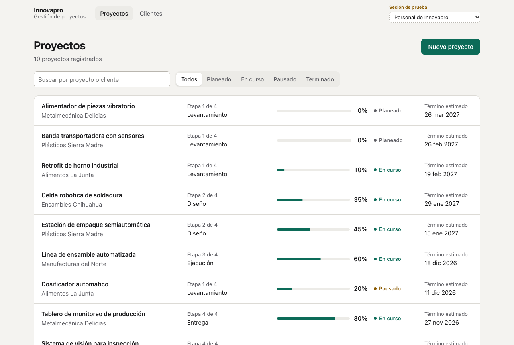
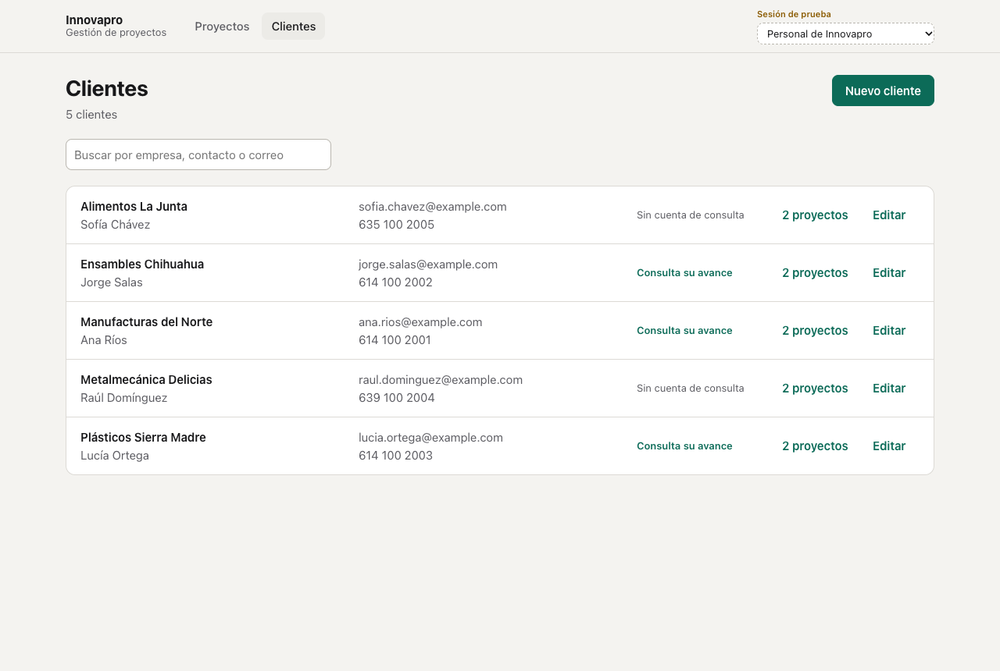
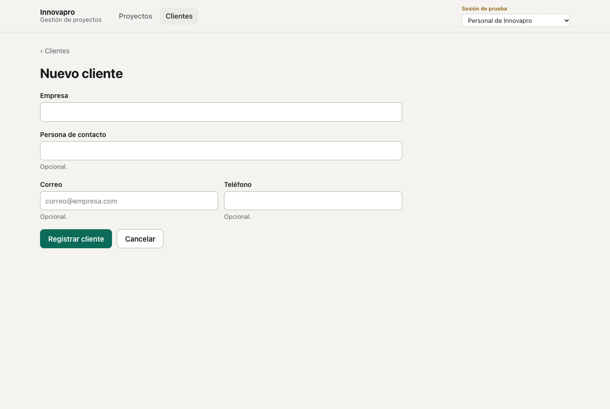
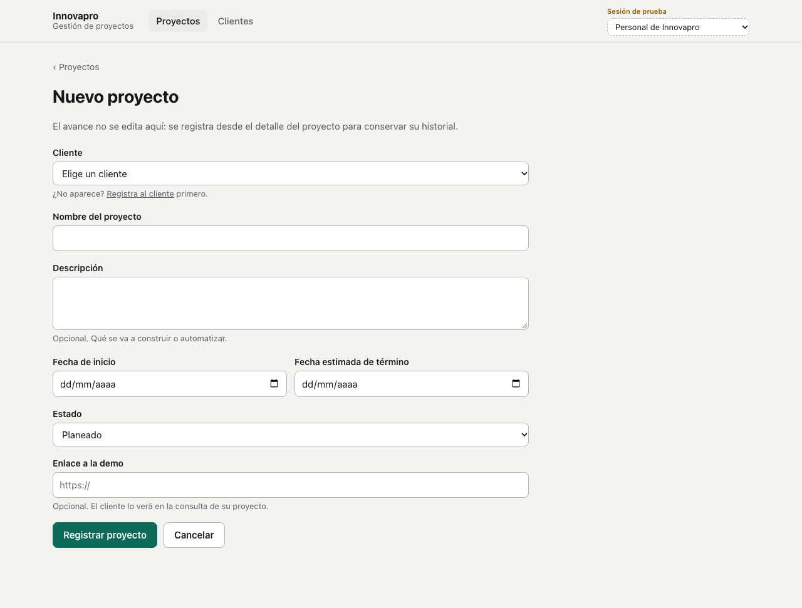
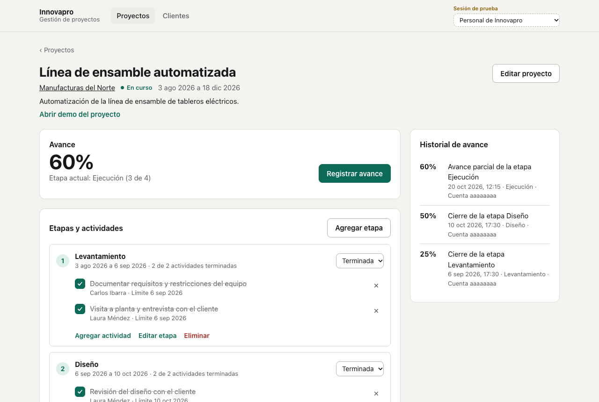
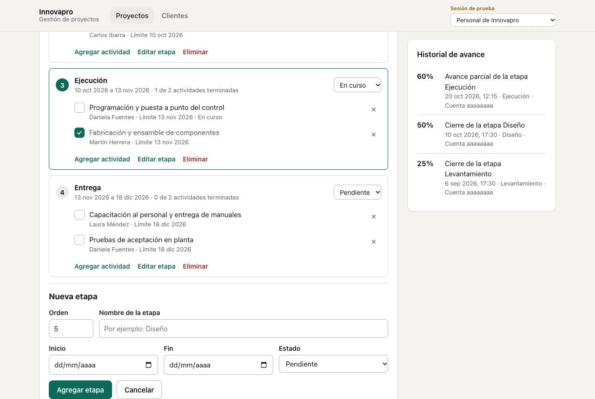
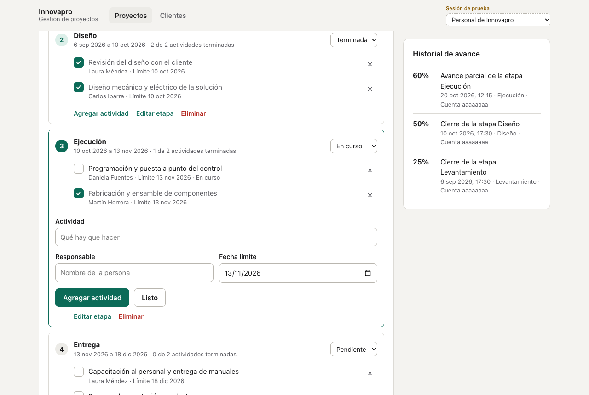
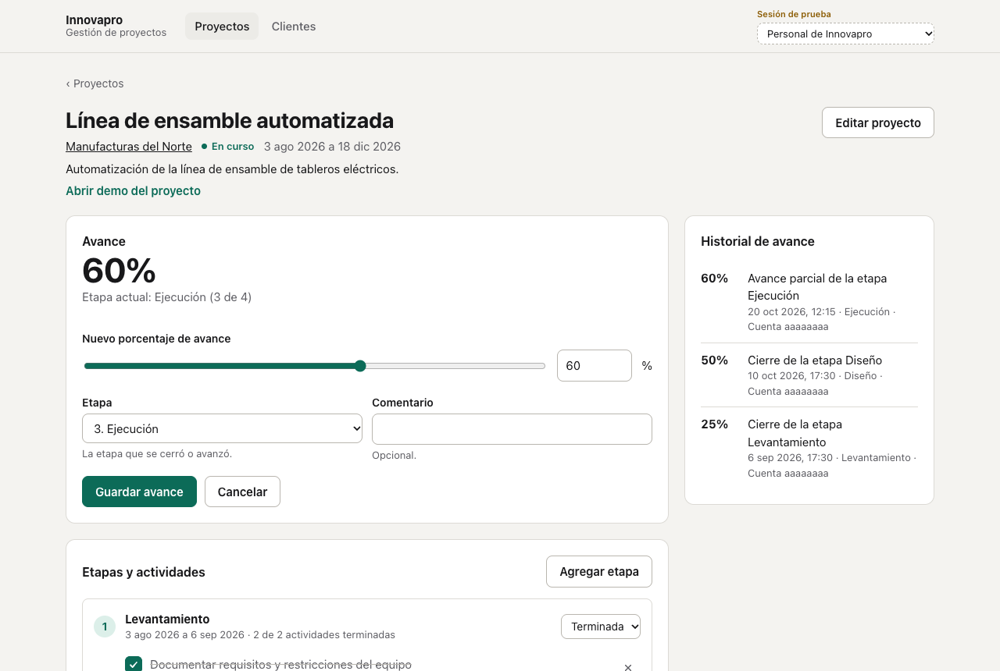
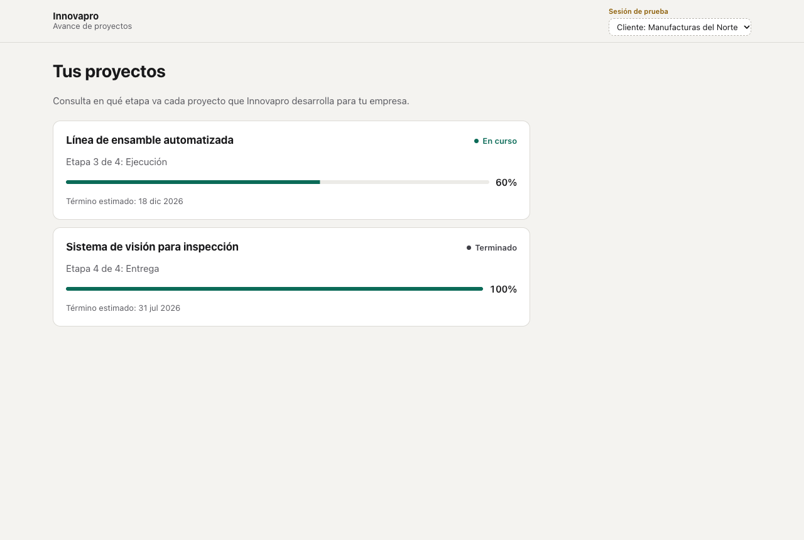
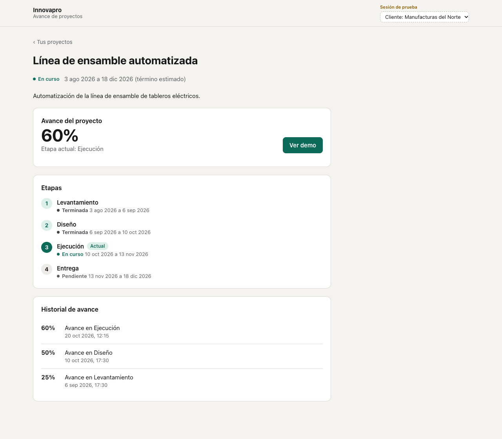

# Manual de usuario: gestión de proyectos de Innovapro

Este manual explica cómo usar el módulo de gestión de proyectos. Lo usan dos tipos de personas:

- **Personal de Innovapro:** registra clientes y proyectos, organiza las etapas y actividades, y actualiza el avance.
- **Clientes:** consultan el avance de sus propios proyectos.

Las capturas usan los datos de prueba del módulo; las empresas y personas que aparecen son ficticias.

## 1. Entrar al módulo

Mientras la plataforma base de Innovapro no tenga inicio de sesión, el módulo funciona con una **sesión de prueba**. En la esquina superior derecha, el selector «Sesión de prueba» permite entrar como personal de Innovapro o como uno de los tres clientes de prueba. Al cambiar de sesión, el módulo abre la pantalla de inicio de esa persona: la lista de proyectos para el personal y «Tus proyectos» para un cliente.

Cuando el inicio de sesión real esté listo, este selector desaparece y cada persona entra con su propia cuenta.

## 2. Lista de proyectos

La pantalla **Proyectos** muestra un renglón por proyecto con:

- el nombre del proyecto y del cliente;
- la etapa actual (por ejemplo, «Etapa 3 de 4, Ejecución»);
- la barra y el porcentaje de avance;
- el estado: planeado, en curso, pausado o terminado;
- la fecha estimada de término.

**Buscar.** Escribe en el buscador parte del nombre del proyecto o del cliente; la lista se actualiza mientras escribes. Si nada coincide, aparece «Ningún proyecto coincide con la búsqueda».

**Filtrar por estado.** Usa los botones Todos, Planeado, En curso, Pausado y Terminado. La búsqueda y el filtro se pueden combinar y se conservan al recargar la página.

Haz clic en un proyecto para abrir su detalle.

## 3. Clientes

La pantalla **Clientes** muestra la empresa, la persona de contacto, el correo, el teléfono, si el cliente tiene cuenta para consultar su avance y cuántos proyectos tiene. El número de proyectos es un enlace que abre la lista de proyectos filtrada por ese cliente.

### Registrar o editar un cliente

1. Haz clic en **Nuevo cliente**, o en **Editar** en el renglón de un cliente.
2. Escribe el nombre de la empresa. Es el único dato obligatorio.
3. Si los tienes, agrega la persona de contacto, el correo y el teléfono.
4. Haz clic en **Registrar cliente** o en **Guardar cambios**.

Si falta el nombre o el correo no es válido, el mensaje aparece debajo del campo y el cliente no se guarda hasta corregirlo.

## 4. Registrar o editar un proyecto

1. En **Proyectos**, haz clic en **Nuevo proyecto**. Para editar uno, abre su detalle y haz clic en **Editar proyecto**.
2. Elige el **cliente**.
3. Escribe el **nombre del proyecto** y, si quieres, una descripción.
4. Indica la **fecha de inicio** y la **fecha estimada de término**. La fecha de término no puede ser anterior a la de inicio.
5. Elige el **estado**. Un proyecto nuevo empieza como «Planeado».
6. Si hay una demostración en línea, pega el enlace; el cliente lo verá en su consulta.
7. Haz clic en **Registrar proyecto** o en **Guardar cambios**.

El cliente, el nombre y las dos fechas son obligatorios. El porcentaje de avance no se cambia aquí: se registra desde el detalle del proyecto (sección 7), para que cada cambio quede en el historial.

## 5. Detalle del proyecto y etapas

El detalle muestra arriba el avance y la etapa actual. Debajo aparecen las etapas con sus actividades y, a un costado, el historial de avance.

Cada etapa muestra su número de orden, su nombre, sus fechas y cuántas de sus actividades están terminadas. La etapa en curso aparece resaltada.

### Agregar una etapa

1. Haz clic en **Agregar etapa**.
2. El orden ya viene propuesto con el siguiente número; cámbialo si hace falta. Dos etapas del mismo proyecto no pueden tener el mismo orden.
3. Escribe el nombre (por ejemplo, Levantamiento, Diseño, Ejecución o Entrega) y, si las conoces, las fechas de inicio y fin.
4. Haz clic en **Agregar etapa**.

### Cambiar el estado, editar o eliminar una etapa

- **Estado:** usa la lista de la derecha de cada etapa (Pendiente, En curso o Terminada). Al marcar una etapa como **Terminada**, se abre el registro de avance para que actualices el porcentaje del proyecto.
- **Editar etapa:** cambia el nombre, el orden o las fechas.
- **Eliminar:** el módulo pide confirmación porque también se eliminan las actividades de la etapa. No se puede deshacer.

## 6. Actividades

### Agregar actividades

1. En la etapa, haz clic en **Agregar actividad**.
2. Escribe qué hay que hacer, el responsable y la fecha límite. Los tres datos son obligatorios; la fecha límite viene propuesta con la fecha de fin de la etapa.
3. Haz clic en **Agregar actividad**.

El formulario se queda abierto y conserva el responsable y la fecha para capturar varias actividades seguidas. Cuando termines, haz clic en **Listo**.

### Marcar una actividad como terminada

Haz clic en la casilla junto a la actividad. La actividad aparece tachada y el conteo de la etapa se actualiza. Si te equivocaste, vuelve a hacer clic para regresarla a pendiente.

Las actividades cuya fecha límite ya pasó sin estar terminadas muestran la palabra **Vencida**.

Para eliminar una actividad, usa la **×** al final de su renglón.

## 7. Registrar el avance

1. En el detalle del proyecto, haz clic en **Registrar avance**. También se abre solo al terminar una etapa.
2. Indica el nuevo porcentaje con la barra o escribiéndolo (de 0 a 100).
3. Elige la etapa que se cerró o avanzó.
4. Si quieres, agrega un comentario, por ejemplo «Cierre de la etapa Diseño».
5. Haz clic en **Guardar avance**.

El historial guarda cada registro con el porcentaje, el comentario, la fecha y hora, la etapa y la cuenta de quien lo registró. El registro más reciente aparece primero. Por ahora la cuenta se muestra con su identificador («Cuenta aaaaaaaa»); cuando la plataforma base tenga perfiles, aparecerá el nombre de la persona.

## 8. Consulta del cliente

Al entrar con una cuenta de cliente aparece **Tus proyectos**, con una tarjeta por cada uno de sus proyectos: el estado, la etapa actual y el porcentaje de avance. El cliente solo ve sus propios proyectos.

Al abrir un proyecto, el cliente ve:

- el avance y la etapa actual;
- el botón **Ver demo**, si el proyecto tiene enlace de demostración;
- las etapas con sus fechas, con la etapa actual marcada;
- el historial de avance.

El cliente no ve las actividades internas ni quién registró cada avance. Si intenta abrir la dirección de un proyecto que no es suyo, el módulo responde «No encontramos este proyecto».

## 9. Mensajes frecuentes

| Mensaje | Qué significa | Qué hacer |
| --- | --- | --- |
| Revisa los datos marcados | Uno o más campos tienen un error. | Lee el mensaje rojo debajo de cada campo y corrígelo. |
| No puede ser anterior a la fecha de inicio | La fecha de término o de fin es anterior a la de inicio. | Cambia una de las dos fechas. |
| Ya hay una etapa con ese orden | Otra etapa del proyecto ya usa ese número. | Usa otro número de orden. |
| El avance debe ser un número entero de 0 a 100 | El porcentaje está fuera de rango o tiene decimales. | Escribe un número entero entre 0 y 100. |
| No se pudieron cargar los proyectos | El módulo no pudo comunicarse con el servidor. | Haz clic en «Intentar de nuevo». Si sigue, avisa al equipo técnico. |
